<div align="center">

  <!-- Terminal Profile Banner with Dithered Pixel-Art Portrait -->
  <picture>
    <source media="(prefers-color-scheme: dark)" srcset="assets/banner-dark.svg">
    <source media="(prefers-color-scheme: light)" srcset="assets/banner-light.svg">
    
  </picture>

  <br/><br/>

  <!-- Animated Typing Status -->
  <a href="https://git.io/typing-svg">
    
  </a>

  <br/>

  <!-- Profile & Social Links -->
  <p align="center">
    <a href="https://github.com/manishjaiswal1702">
      
    </a>
    <a href="https://www.linkedin.com/in/manish-kumar-jaiswal-533691295/">
      
    </a>
    <a href="mailto:manishjaiswal4043@gmail.com">
      
    </a>
    <a href="https://leetcode.com/u/Manish_jaiswal_1702/">
      
    </a>
    <a href="https://www.geeksforgeeks.org/profile/manish1702">
      
    </a>
  </p>

</div>

---

### 👨‍💻 About Me

```yaml
candidate: Manish Kumar Jaiswal
education: B.Tech in Computer Science & Engineering (Artificial Intelligence)
institution: KIET Group of Institutions (2023 - 2027)
location: India
core_specializations:
  - Full Stack Web Architecture & Microservices (MERN, Redis, RabbitMQ, Docker)
  - Cloud-Native Deployments & Kubernetes Sandbox Provisioning
  - Generative AI & Agentic Systems (LangChain, LangGraph, RAG, Multi-LLM Orchestration)
  - Algorithmic Problem Solving (320+ DSA Problems Solved)
status: Open to Software Engineering, Full Stack & AI Engineering Opportunities
```

- 🎓 **Undergraduate** in Computer Science & Engineering (Artificial Intelligence) at **KIET Group of Institutions** (Graduation: 2027).
- ☁️ **AWS Certified Cloud Practitioner** (Issued Feb 2026), experienced with containerized microservices on AWS, Docker, and Kubernetes.
- 🤖 **GenAI & Agent Developer** building intelligent workflows with **LangChain**, **LangGraph**, **RAG**, and multi-model pipelines (**Mistral**, **Gemini**, **Cohere**).
- ⚡ **Competitive Programmer** with 320+ data structures and algorithms problems solved across **LeetCode** and **GeeksforGeeks**.

---

### 🛠️ Technical Skills

<div align="center">

#### 💻 Programming Languages
<p>
  
  
  
  
</p>

#### 🌐 Frontend Development
<p>
  
  
  
  
  
</p>

#### ⚙️ Backend, Messaging & Databases
<p>
  
  
  
  
  
  
  
  
  
  
</p>

#### 🧠 Artificial Intelligence & GenAI
<p>
  
  
  
  
  
  
  
</p>

#### ☁️ Cloud, DevOps & Tools
<p>
  
  
  
  
  
  
  
  
</p>

#### 📚 Core Computer Science
<p>
  
  &bull;
  
  &bull;
  
  &bull;
  
</p>

</div>

---

### 🚀 Featured Projects

<div align="center">

| Project | Tech Stack | Highlights | Repository |
| :--- | :--- | :--- | :---: |
| **🌌 NovaSpace** | `Kubernetes` `Docker` `Redis` `RabbitMQ` `LangChain` `Mistral AI` `Node.js` `OAuth` | &bull; Cloud-native AI platform provisioning isolated sandbox environments on Kubernetes.<br/>&bull; Architected 4 microservices: authentication, AI orchestration, sandbox provisioning, and notifications.<br/>&bull; Implemented Redis-based sandbox lifecycle management to remove inactive pods after 20 minutes.<br/>&bull; Integrated LangChain, Mistral AI, RabbitMQ, OAuth and JWT authentication. | [**View Code**](https://github.com/manishjaiswal1702/backend_2.0/tree/main/NovaSpace) |
| **⚔️ ClashMind AI** | `React.js` `Tailwind CSS` `Node.js` `Express.js` `LangGraph` `Mistral` `Cohere` `Gemini` | &bull; AI coding arena enabling real-time AI-vs-AI problem-solving with automated evaluation.<br/>&bull; Integrated Mistral, Cohere, and Gemini models for code generation, scoring, and response comparison.<br/>&bull; Built complex multi-agent orchestration flows using LangGraph. | [**View Code**](https://github.com/manishjaiswal1702/ClashMind-AI) |
| **💬 Inquira AI** | `React.js` `Tailwind CSS` `Redux Toolkit` `Node.js` `Express.js` `MongoDB` `Socket.IO` | &bull; Real-time AI chat application featuring streaming AI-generated conversational responses.<br/>&bull; Developed robust REST APIs and real-time messaging pipeline using Node.js, Express, MongoDB, and Socket.IO.<br/>&bull; Built a responsive frontend with React.js, Tailwind CSS, and state management via Redux Toolkit. | [**View Code**](https://github.com/manishjaiswal1702/Inquira-AI) |

</div>

---

### 🏆 Achievements & Certifications

- 🏅 **320+ DSA Problems Solved** across [LeetCode](https://leetcode.com/u/Manish_jaiswal_1702/) and [GeeksforGeeks](https://www.geeksforgeeks.org/profile/manish1702), mastering core algorithmic patterns, trees, graphs, and dynamic programming.
- ☁️ **AWS Certified Cloud Practitioner** &mdash; *Amazon Web Services* (Issued February 2026).
- 🚀 **SprintHacks 2.0 Hackathon** &mdash; *GDSC, KIET Group of Institutions* (May 2024): Contributed to frontend engineering and UI responsiveness for a collaborative recipe sharing platform using HTML, CSS, and JavaScript.

---

### 💡 Coding Profiles

<div align="center">
  <a href="https://leetcode.com/u/Manish_jaiswal_1702/">
    
  </a>
  &nbsp;&nbsp;&nbsp;&nbsp;
  <a href="https://www.geeksforgeeks.org/profile/manish1702">
    
  </a>
</div>

---

### 📊 GitHub Activity & Analytics

<div align="center">
  
  &nbsp;
  
</div>

<br/>

<div align="center">
  
</div>

---

### 🐍 Contribution Activity

<!-- 
  NOTE: The contribution snake animation below requires a separately configured 
  GitHub Actions workflow (e.g. using Platane/snk@v3) configured to commit 
  'github-contribution-grid-snake.svg' and 'github-contribution-grid-snake-dark.svg' 
  to an 'output' branch. Once the workflow runs, the snake animation will display automatically.
-->

<div align="center">
  <picture>
    <source media="(prefers-color-scheme: dark)" srcset="https://raw.githubusercontent.com/manishjaiswal1702/manishjaiswal1702/output/github-contribution-grid-snake-dark.svg">
    <source media="(prefers-color-scheme: light)" srcset="https://raw.githubusercontent.com/manishjaiswal1702/manishjaiswal1702/output/github-contribution-grid-snake.svg">
    
  </picture>
</div>

---

<div align="center">

  *"Transforming complex problems into resilient, scalable systems."*

  <br/>

  <p>
    <b>Get in Touch:</b>
    <br/>
    <a href="https://github.com/manishjaiswal1702">
      
    </a>
    &bull;
    <a href="https://www.linkedin.com/in/manish-kumar-jaiswal-533691295/">
      
    </a>
    &bull;
    <a href="mailto:manishjaiswal4043@gmail.com">
      
    </a>
    &bull;
    <a href="https://leetcode.com/u/Manish_jaiswal_1702/">
      
    </a>
    &bull;
    <a href="https://www.geeksforgeeks.org/profile/manish1702">
      
    </a>
  </p>

  <sub>© 2026 Manish Kumar Jaiswal &bull; Built with passion & precision</sub>

</div>
